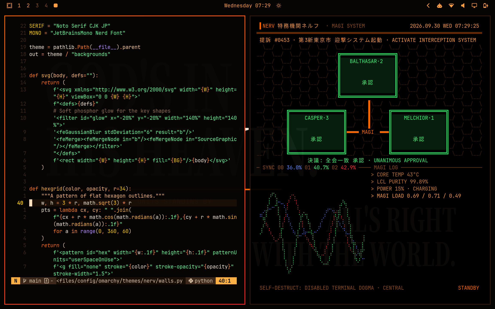
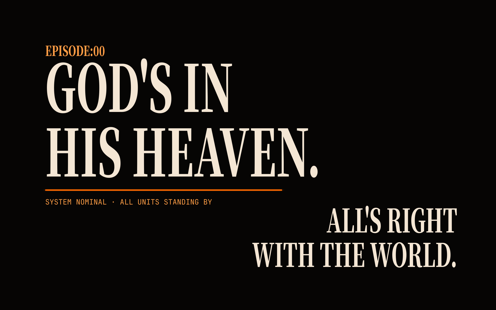
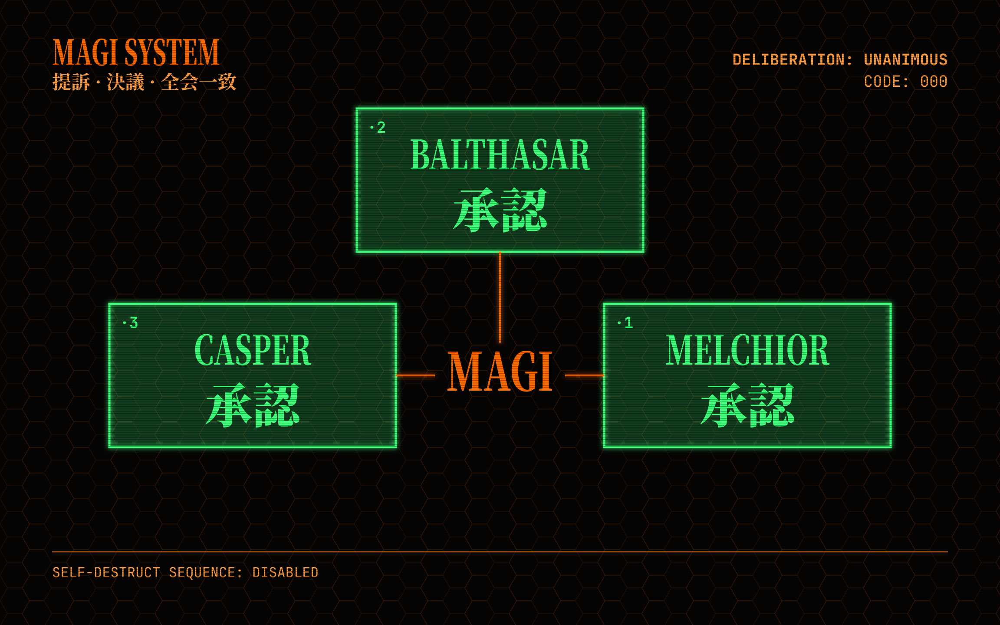
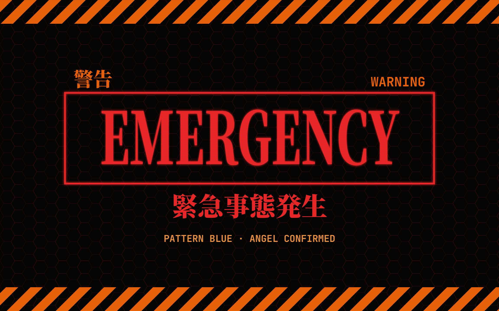

# NERV

An [Omarchy](https://omarchy.org) theme in NERV's colors: warning orange on
black, with emergency red, MAGI green and Unit-01 purple.



## Install

```sh
omarchy theme install https://github.com/roydq/omarchy-nerv-theme
```

That installs and applies it; afterwards it's in the theme picker as NERV.
Cycle the wallpapers with `omarchy theme bg next`.

## What's in it

- `colors.toml`, the palette. Omarchy themes the terminal, bar, lock screen,
  notifications, btop, Neovim and the rest from it, and gives windows an
  orange-to-red border.
- Three wallpapers, drawn as type and shapes by `walls.py`:

| Title card | MAGI | Emergency |
| --- | --- | --- |
|  |  |  |

## The MAGI screensaver

[MAGI](https://github.com/roydq/omarchy-magi) is a terminal screensaver for
Omarchy made to go with this theme (it's the right-hand pane in the screenshot
above). It follows whichever theme is active, so it looks its NERV best with
this one.

## Editing the wallpapers

`walls.py` renders the wallpapers and the picker preview (it needs
`rsvg-convert`, which Omarchy ships, and the Noto Serif CJK font). Edit the
text or layout, then run it and reapply the theme:

```sh
~/.config/omarchy/themes/nerv/walls.py
omarchy theme set nerv
```

## tokyonight.nvim

Omarchy colors Neovim from the palette on its own. `tokyonight.lua` is an
optional hand-tuned palette for tokyonight.nvim that's easier to read code in
(the generic mapping is very orange). Omarchy doesn't load Lua from installed
themes, so it only matters if your Neovim config registers it as a
tokyonight style:

```lua
package.loaded['tokyonight.colors.nerv'] = dofile(vim.fn.expand '~/.config/omarchy/themes/nerv/tokyonight.lua')
require('tokyonight').setup { style = 'nerv' }
vim.cmd.colorscheme 'tokyonight'
```

## Credits

An unofficial fan work, not affiliated with or endorsed by the makers of
*Neon Genesis Evangelion*. NERV, MAGI and Evangelion belong to their
respective owners. The wallpapers use the Noto Serif CJK and JetBrains Mono
fonts.

## License

[MIT](LICENSE)
